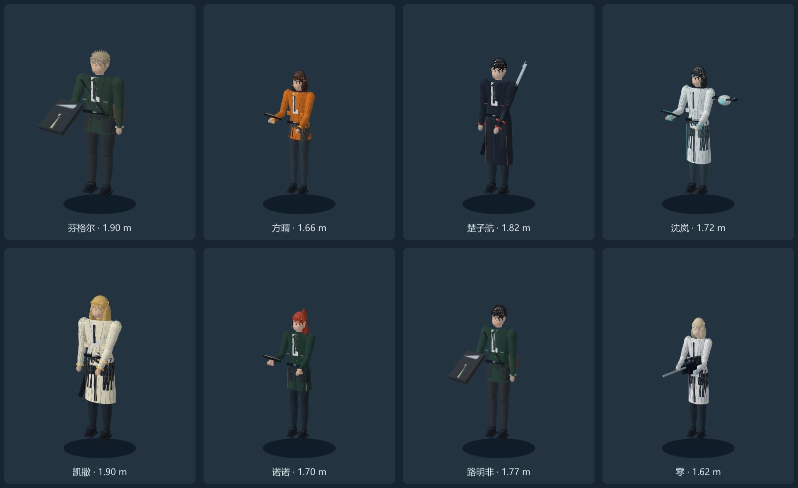

# 正常比例战斗模型

八套实际 3D 网格，单位为米，约 7.4 头身；身高 1.62–1.90 m。俯视战斗以各自发型、服装色块、装备和动作区分人物。采用风格化轻量模型，不是 Q 版精灵，也不是写实扫描资产。角色为本项目的非官方同人诠释。

| GLB | 人物 | 装备 |
| --- | --- | --- |
| fingel.glb | 芬格尔 | 护盾、挎包 |
| fangqing.glb | 方晴 | 通信信标、耳麦 |
| chuzihang.glb | 楚子航 | 刀与刀鞘、黑色长外套 |
| shenlan.glb | 沈岚 | 平板、眼镜、医疗无人机 |
| caesar.glb | 凯撒 | 猎刀、白色长外套 |
| nono.glb | 诺诺 | 扫描终端、红发马尾 |
| lumingfei.glb | 路明非 | 应急盾、制服与挎包 |
| zero.glb | 零 | 步枪、瞄具、白色外套 |

源模型与关节动作在 `../../character-models.js`，运行时直接生成，无外部纹理、GLB 加载器或网络请求，因此可通过 `file://` 离线启动。GLB 由 `node scripts/export-models.cjs` 导出，供三维编辑器继续修改；仅修改导出文件不会自动改变运行时模型，需要同步源模型。

每套含 16–17 个关节节点和 idle / walk / attack / skill 四段动画。采用刚性分件关节结构，不是带蒙皮权重的整身角色；衣摆和马尾为程序摆动，非布料物理。相同关节下按材质合并网格，控制绘制次数。战斗使用软阴影、地面光照、待机呼吸、受击颜色反馈、定向挥击、持续护盾、火花、倒地动作和独立武器特效。

上图通过 `scripts/preview-models.cjs` 对实际网格进行离线三角形投影，需 Node.js 的 sharp 包。它用于检查身材、轮廓与装备，**不是游戏截图**；不包含 WebGL 的平滑光照和阴影。真实游戏窗口的视觉、帧率和 GPU 兼容性仍需实机验收。

Third-party renderer: Three.js 0.180.0, MIT. See `../vendor/THREE-LICENSE.txt`.
