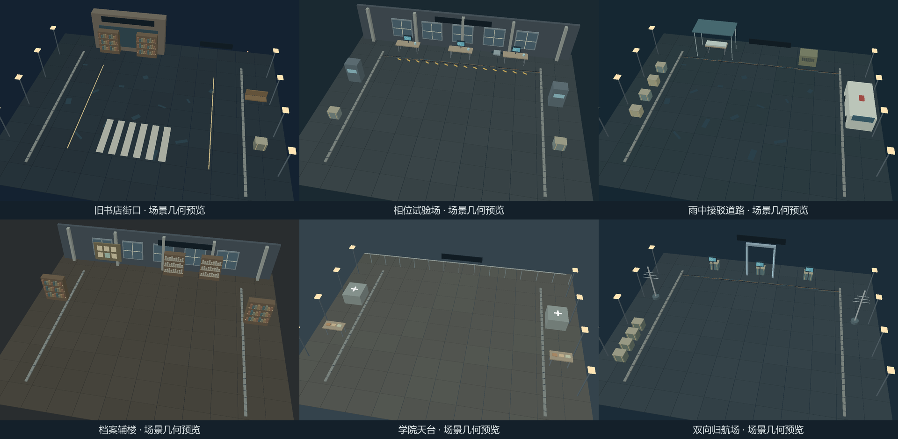

> 说明：本目录对应旧版战斗（源码已移至 `legacy/`）。当前自走棋战斗的人物与场景见 `hero-models.js` 与 `autochess-render.js`。

# 剧情战场场景

`battle-scenery.js` 为第一章的 20 个任务分别创建场景：旧书店街口、地下研究所、相位试验场、紧急物资站、首次锚定走廊、学院接待处、学生餐厅外、空白站台、雨中接驳道路、临时实验室、档案辅楼、临时中继站、记忆回廊、学院天台、信号交换层、站台主控机房、临时归航室、返航路线、双向归航场、旧通道出口。

书架、样本、医疗雨棚、时刻表、天台餐盒与通信设备呼应对应剧情。高于地面的物件布置在战斗移动区域之外。每关 216–330 个静态零件通过实例化合并为 3–8 个批次；该数字不包含角色、文字、天气、动态物件与阴影绘制，也不是实际帧率指标。低画质减少天气和灯光开销。

上图由 `scripts/preview-scenery.cjs` 使用 CPU 深度缓冲投影实际网格，供检查场景布局与物件轮廓，**不是游戏截图**。不含游戏中的文字贴图、角色、天气、软阴影与完整光照。生成需要 Node.js 与 sharp；运行 `node scripts/preview-scenery.cjs`。真实窗口的视觉、帧率与 GPU 兼容性仍需实机验收。
